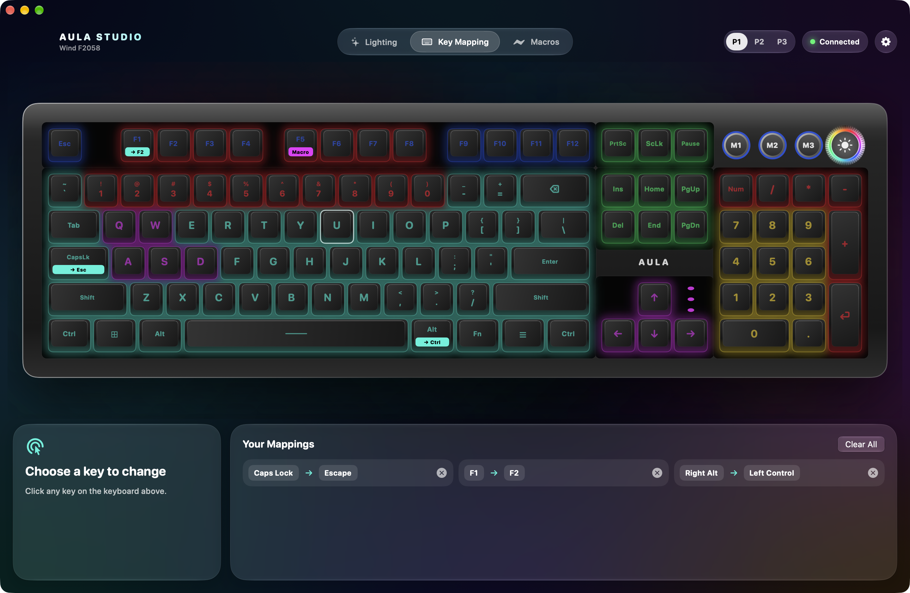

# AULA Studio

**A native Mac app for the AULA Wind F2058 mechanical keyboard.**

AULA's official configuration software only runs on Windows. AULA Studio brings lighting control, key mapping, macros, and profiles to macOS, with a Liquid Glass interface and a live, animated drawing of your keyboard.



> This is an independent community project. It is not made, endorsed, or supported by AULA.

## Why use AULA Studio?

| | AULA Studio | Official AULA software |
|---|---|---|
| **Runs on macOS** | ✅ Native Mac app | ❌ Windows only |
| **Kernel driver required** | ✅ None | ⚠️ Installs a keyboard filter driver |
| **Live animated effect preview** | ✅ Drawn key by key | — |
| **Mappings affect only the AULA keyboard** | ✅ Your Mac's built-in keyboard stays untouched | — |
| **Command-line control** | ✅ Included | — |
| **Readable JSON profiles** | ✅ Through the command-line tool | — |
| **Firmware commands blocked by design** | ✅ Only known-safe lighting commands can be sent | ❌ Includes an upgrade feature |
| **Open source** | ✅ | ❌ |

## Features

### Lighting
- All **20 built-in effects**, each with an animated preview
- **13 brightness levels** and **3 animation speeds**
- The three **M1, M2, and M3** game-key layouts
- Changes save to the keyboard automatically, so they stay after you unplug it

### Key mapping
- Click a key, then click what it should act as
- Applies to the AULA keyboard only
- Restored automatically when the keyboard reconnects while the app is running

### Macros
- Combine typed text, key shortcuts, and timed delays
- Trigger a macro from any supported key
- Repeat a macro up to 50 times
- Hold up to 8 macros per profile

### Profiles
- Three profiles, **P1, P2, and P3**
- Each profile keeps its own lighting, mappings, and macros

### Always ready
- **Launch at Login** is available from the gear button
- Closing the window keeps AULA Studio running in the menu bar

## Install

**Requirements:** an Apple Silicon Mac running macOS 26 or newer, and an AULA Wind F2058 connected by USB.

1. Download the latest `AULA-Studio.zip` from the [Releases page](../../releases/latest).
2. Unzip it and move **AULA Studio** to your **Applications** folder.
3. Open the app. If macOS says it can't verify the developer, go to **System Settings > Privacy & Security** and click **Open Anyway**.
4. Click **Allow Access** in the app, turn on **AULA Studio** under **Input Monitoring**, then quit and reopen the app.
5. To use macros, turn on **AULA Studio** under **Privacy & Security > Accessibility** when macOS asks.

### Why these permissions?

| Permission | What it's used for |
|---|---|
| **Input Monitoring** | Sending lighting settings to the keyboard |
| **Accessibility** | Letting macros type on your behalf |

AULA Studio doesn't record your keystrokes or send your data anywhere.

## Use it with another AULA keyboard

AULA Studio is built and tested for the **F2058 only**. Other AULA keyboards may work if they use the same controller, but each one needs to be checked first.

### 1. Find your keyboard's IDs

```bash
system_profiler SPUSBHostDataType | grep -B6 -A6 -i "keyboard"
```

Note the **USB Vendor ID** and **USB Product ID**.

| Vendor ID | What it means |
|---|---|
| `0x1a2c` and Product ID `0x9ef4` | This is the supported F2058. Use the normal install steps. |
| `0x1a2c` with another Product ID | It may be compatible. Continue to step 2. |
| Any other Vendor ID, such as `0x0c45` | It uses a different protocol. **Don't force this app onto it.** |

### 2. Check its command channel

Edit `VID` and `PID` at the top of `tools/phase1_identify.py`, then run:

```bash
python3 -m venv .venv
```

```bash
.venv/bin/pip install hidapi
```

```bash
.venv/bin/python tools/phase1_identify.py
```

Continue only if the output lists **report ID `0x07`** as both a **feature** and an **output** report, each with a **7-byte payload**.

### 3. Add your keyboard's IDs

Change the IDs in both of these files:

- `app/Sources/AulaStudio/AulaProtocol.swift`: `vendorID` and `productID`
- `aula/protocol.py`: `VENDOR_ID` and `PRODUCT_ID`

### 4. Build and test carefully

Install Xcode, then build the app:

```bash
cd app && ./build.sh
```

Open `app/build/AULA Studio.app` and change only the **brightness** first, because it's easy to undo. Then try one effect at a time. Effects, key layouts, and brightness ranges may differ from the F2058.

**Never send commands you don't understand to a keyboard.** The wrong command could leave it needing a reset or repair, and you adapt this software at your own risk.

If it works, please open an issue with your keyboard model and IDs so others can benefit.

## Command-line tool

The repository also includes a Python command-line tool:

```bash
python3 -m venv .venv
```

```bash
.venv/bin/pip install -e .
```

| Task | Command |
|---|---|
| Set lighting | `.venv/bin/aula lighting --mode wave --brightness 13 --speed 1` |
| Choose a game-key layout | `.venv/bin/aula lighting --mode gaming-keys --slot M2` |
| Preview without changing anything | `.venv/bin/aula --dry-run lighting --mode sine` |
| Remap a key | `.venv/bin/aula remap CAPSLOCK ESC` |
| Remove all remaps | `.venv/bin/aula remap --clear` |
| Save a profile | `.venv/bin/aula profile save desk.json` |
| Load a profile | `.venv/bin/aula profile load desk.json` |

The terminal app you use needs Input Monitoring permission to change lighting.

## Test status

| Feature | Status on a real F2058 |
|---|---|
| 20 lighting effects | ✅ Confirmed |
| M1, M2, and M3 layouts | ✅ Confirmed |
| Brightness levels and maximum | ✅ Confirmed |
| 3 speed levels | ✅ Confirmed |
| Saving lighting after unplugging | ✅ Confirmed |
| Key mapping | ✅ Confirmed |
| JSON profiles | ✅ Confirmed |
| Macros in AULA Studio | 🧪 Built, awaiting wider testing |
| Factory reset in the command-line tool | ⚠️ Not yet tested |

## Known limitations

- **Custom colors aren't possible.** Each key has one fixed LED color.
- **The keyboard's current settings can't be read.** Changes made with the keyboard's own shortcuts won't appear in the app.
- **Macros run on your Mac.** AULA Studio must stay open, and closing its window keeps it running in the menu bar.
- **Key mappings need the app after a restart.** macOS clears them until AULA Studio opens again, so turn on Launch at Login to restore them automatically.
- **Effect previews are close approximations** of the keyboard's real animations.

## Build from source

Requires macOS 26 or newer and Xcode.

```bash
cd app && ./build.sh
```

Run the Python tests from the project folder:

```bash
.venv/bin/python -m unittest discover -s tests
```

## Project layout

| Path | Contents |
|---|---|
| `app/` | AULA Studio, the SwiftUI Mac app |
| `aula/` | Python command-line tool |
| `tests/` | Command-line tool tests |
| `tools/` | Device inspection and testing scripts |
| `docs/` | README images |
| `PROTOCOL.md` | The reverse-engineered USB protocol and test log |

## License

AULA Studio is available under the [MIT License](LICENSE).

## Credits

The community's [AULA F2067 protocol research](https://github.com/progzone122/aegis-2067usb-protocol) was a valuable starting point for understanding this keyboard family.

AULA is a trademark of its respective owner and is used here only to identify compatible hardware.
